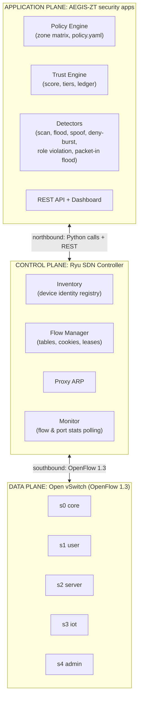
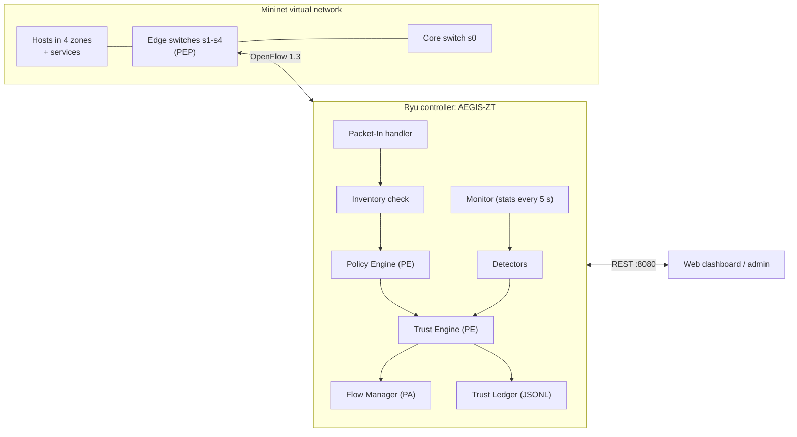
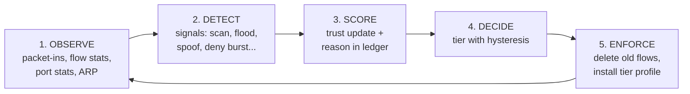
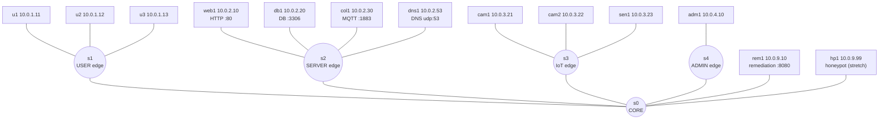
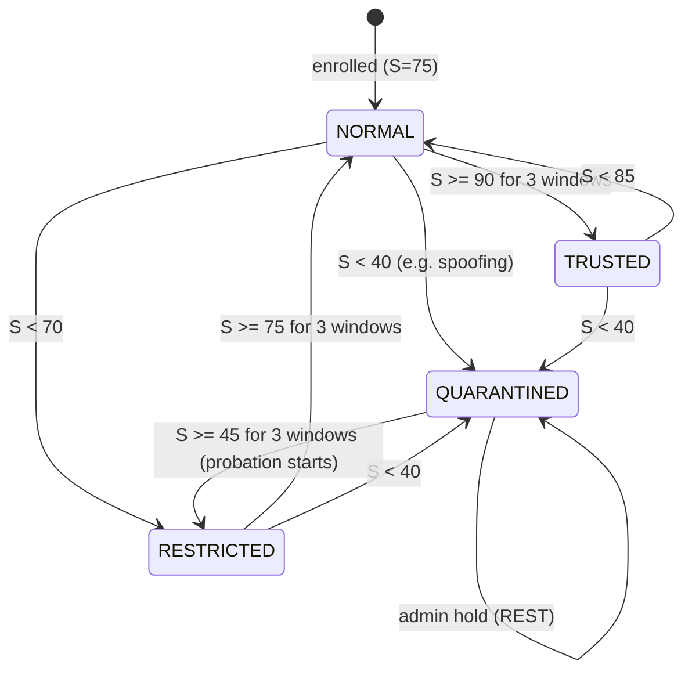
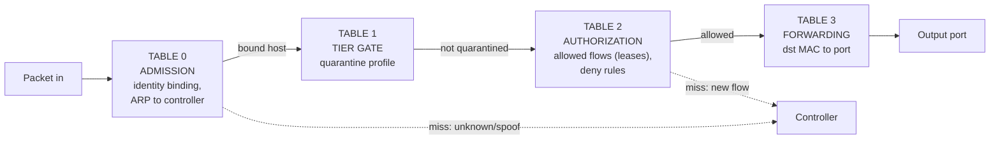
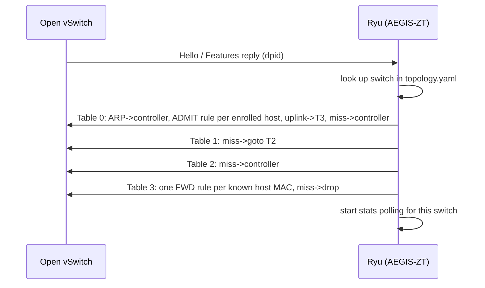
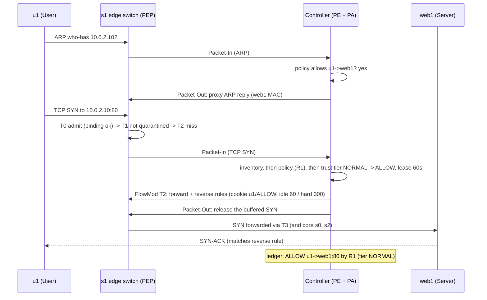
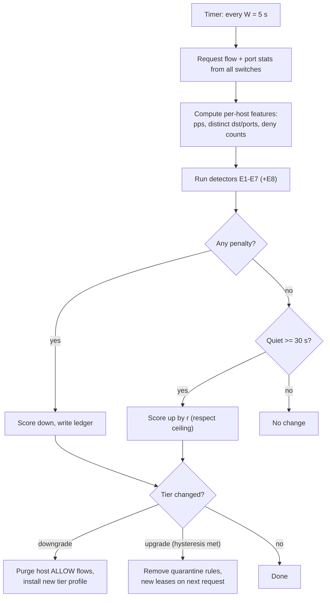

# Phase 2: SDN/SDS Design & Architecture
## AEGIS-ZT: Adaptive, Explainable, Graded Isolation System for Zero Trust SDN

> **Project:** SDN-Based Zero Trust Micro-Segmentation and Dynamic Access Control Framework
> **Course:** Software Defined Security (BMU, CSE 2023, 7th Sem, Cyber Security). Faculty: Dr. Sumit Badotra
> **Phase 2 rubric (10 marks):** well-structured architecture · justified controller/tool choices · architecture diagrams, workflow and topology · understanding of SDS concepts
> **Who this is for:** the people building Phase 3 (code), the people writing the report, and the people making the PPT. Everything is in this one file.
> **Status:** design baseline v1.0 (14 Oct 2026). If something changes during Phase 3, update this file first.

Diagrams are written in **Mermaid**. They render in VS Code (Markdown Preview Mermaid Support extension), on GitHub, and at https://mermaid.live (export PNG/SVG from there for the report and PPT).

---

## Table of Contents
0. [One-page summary (start here)](#0-one-page-summary-start-here)
1. [Brainstorm: how we got to this design](#1-brainstorm-how-we-got-to-this-design)
2. [What makes AEGIS-ZT different (the 7 differentiators)](#2-what-makes-aegis-zt-different-the-7-differentiators)
3. [Design goals and requirements](#3-design-goals-and-requirements)
4. [Architecture](#4-architecture)
5. [Network topology and addressing plan](#5-network-topology-and-addressing-plan)
6. [Zone policy (the micro-segmentation matrix)](#6-zone-policy-the-micro-segmentation-matrix)
7. [The trust engine (dynamic access control)](#7-the-trust-engine-dynamic-access-control)
8. [OpenFlow pipeline and flow-rule design](#8-openflow-pipeline-and-flow-rule-design)
9. [Workflows (step by step)](#9-workflows-step-by-step)
10. [Module design (software architecture for Phase 3)](#10-module-design-software-architecture-for-phase-3)
11. [Tools and technology choices, with justification](#11-tools-and-technology-choices-with-justification)
12. [Threat model and security coverage](#12-threat-model-and-security-coverage)
13. [Experiment and evaluation design (feeds Phase 5)](#13-experiment-and-evaluation-design-feeds-phase-5)
14. [Phase 3 implementation plan](#14-phase-3-implementation-plan)
15. [Demo storyline (Phase 7)](#15-demo-storyline-phase-7)
16. [Report and PPT guide for the team](#16-report-and-ppt-guide-for-the-team)
17. [Viva preparation: likely questions and answers](#17-viva-preparation-likely-questions-and-answers)
18. [Assumptions, limitations and future scope](#18-assumptions-limitations-and-future-scope)
19. [Rubric coverage checklist](#19-rubric-coverage-checklist)
20. [Glossary](#20-glossary)

---

## 0. One-page summary (start here)

**The problem (from Phase 1):** once an attacker gets inside a network, they move freely from machine to machine (lateral movement). Existing work either *draws zones that don't react* or *detects threats without blocking them at the network*.

**Our system, AEGIS-ZT, in one sentence:**
An SDN controller that splits the network into locked zones (default-deny), gives every device a live, explainable **trust score**, and automatically **grades** each device's access (Trusted → Normal → Restricted → Quarantined) by rewriting OpenFlow rules within seconds.

**How it works, in three layers:**

| Layer | Name | What it does | Where it lives |
|---|---|---|---|
| 1 | **Walls** | Four zones (User, Server, IoT, Admin) + services. Every connection is denied unless the policy file allows it, *even inside the same zone*. | `policy.yaml` + Ryu policy engine |
| 2 | **Watch** | The controller watches every device (scans, floods, spoofing, forbidden attempts) and updates a 0–100 trust score with a written reason for every change. | Ryu trust engine + detectors |
| 3 | **Act** | When the score crosses a tier boundary, the controller deletes the device's old rules and installs the rules for its new tier. | Ryu flow manager → Open vSwitch |

**What's new compared with the 22 papers we reviewed (details in §2):**
1. **Graded isolation:** four trust tiers with four different access profiles, not just allow/block.
2. **Trust-proportional flow leases:** low-trust devices are re-verified more often, high-trust ones less often.
3. **Explainable trust ledger:** every point lost has a reason you can show on screen.
4. **Network invisibility:** the controller answers ARP itself, so forbidden devices simply don't exist for you.
5. **Identity-bound admission:** port + MAC + IP binding stops spoofing at the first switch.
6. **Policy-as-code:** a readable YAML file, hot-reloadable through a REST API.
7. **Containment-focused evaluation:** we measure *blast radius* and *time-to-contain*, not just accuracy.

**Stack:** Mininet · Open vSwitch (OpenFlow 1.3) · Ryu controller (Python) · REST API + live web dashboard · nmap / hping3 / iperf3 / scapy for tests · Wireshark/tcpdump for evidence.

**How we prove it (Phase 5):** compare three set-ups: **B0** flat network, **B1** static zones (no trust), **B2** AEGIS-ZT. Run six scenarios (scan, lateral movement, flood, spoofing, slow scan, heavy-but-legitimate traffic). Measure detection (precision/recall/F1/FPR/FNR), containment (blast radius, time-to-detect, time-to-contain) and cost (latency, throughput, loss, CPU, memory, flow-table size).

---

## 1. Brainstorm: how we got to this design

This section records *why* the design looks the way it does. The report's "design justification" and the viva both need it.

### 1.1 Starting point: what Phase 1 told us

| Gap from Phase 1 | Design response |
|---|---|
| Walls that don't react (papers 2, 3, 12, 15) | Trust score changes the access profile in real time |
| Reflexes that don't block (papers 4, 5, 7) | Every detection feeds the trust score, and tier changes rewrite flow rules |
| Trust in the wrong place: blockchain/database (8, 9, 10, 12) | Trust is enforced *at the switch*, so lateral movement is physically stopped |
| Zones are not the foundation (13, 14, 21) | Default-deny zone matrix is Layer 1. Trust only ever *narrows* what the matrix allows. |
| Hard to reproduce, thin proof (1, 4, 11, 19) | Standard OpenFlow 1.3, Open vSwitch, Ryu, Mininet; scripted experiments with baselines |

### 1.2 Ideas we considered, and what we chose

| Question | Options considered | Decision | Why |
|---|---|---|---|
| How to segment? | VLANs per zone · IP subnets + router · **identity-based zones in the controller** | **Identity-based** | Zero Trust says segment by *who you are*, not *where you plug in*. VLANs and subnets are location-based and coarse. The controller already knows each device's identity. |
| Granularity? | Zone-to-zone only · **per-service (host + protocol + port)** | **Per-service** | "User may reach web1 on TCP 80" is true least privilege. Zone-to-zone would let a user hit every port on every server. |
| Intra-zone traffic? | Allow (classic) · **Deny by default** | **Deny** | Laptop-to-laptop is a classic lateral-movement path. Real micro-segmentation blocks it. |
| Reactive or proactive rules? | Proactive (pre-install all) · Reactive (first packet asks controller) · **Hybrid** | **Reactive for authorization, proactive for forwarding** | Reactive gives a decision point for *every new flow* (continuous verification) and lets us see attempts. Forwarding rules are pre-installed so allowed traffic stays fast. |
| How to decide trust? | Pure ML · **Score-based with explainable signals + optional ML signal** | **Explainable score** | Needs no training data, is deterministic, tunable and explainable in the viva. ML can be added as *one more signal* in Phase 4. NIST SP 800-207 describes score-based trust algorithms. |
| Binary or graded response? | Allow/Block · **Graded tiers** | **4 tiers** | Binary responses either over-react (killing a server for one odd packet) or under-react. Tiers let us shrink access step by step. |
| How fast to re-check? | Fixed timeout for all flows · **Lease length depends on trust** | **Trust-proportional leases** | Suspicious devices get re-verified often; healthy ones don't waste controller time. |
| Where to enforce? | Every switch · **At the edge (first-hop) switch** | **Edge** | Stops bad traffic as close to the source as possible. Core stays simple and fast. |
| Hide or refuse forbidden hosts? | Normal ARP flooding · **Controller answers ARP (proxy ARP)** | **Proxy ARP** | Devices can't discover hosts they aren't allowed to reach. That's software-defined-perimeter-style "dark network" behaviour, inside the LAN. |
| Controller? | POX · Floodlight · ONOS · OpenDaylight · **Ryu** | **Ryu** (os-ken as fallback) | Python, lightweight, full OpenFlow 1.3, easy to read and explain. See §11. |

### 1.3 Ideas parked for later (future scope or stretch)
- OVS connection tracking (conntrack) for true stateful firewalling (§18).
- Multi-controller / high availability (§18).
- Real device posture (patch level, antivirus) as a trust input.
- An ML anomaly signal (Isolation Forest). Designed in §7.6 as a **Phase 4 stretch**.
- A deception redirect that sends quarantined scanners to a honeypot. Designed in §8.6 as a **Phase 4 stretch**.

---

## 2. What makes AEGIS-ZT different (the 7 differentiators)

Every differentiator uses **established, proven mechanisms**. The novelty is in how they are combined and applied. "Different from" refers to the 22 papers reviewed in Phase 1.

| # | Differentiator | Plain-words explanation | Proven mechanism underneath | Contrast with the literature |
|---|---|---|---|---|
| D1 | **Graded isolation** | Access shrinks in steps (Trusted → Normal → Restricted → Quarantined) instead of a single on/off switch. | OpenFlow rule sets per tier, priorities, cookie-based bulk delete | Most work does detect-only [4][5][7] or binary block [14][21] |
| D2 | **Trust-proportional flow leases** | Every allowed connection gets a "lease" (rule timeout). Low trust means a short lease, so the device is re-checked often. | OpenFlow `idle_timeout` / `hard_timeout` | Continuous verification usually means fixed intervals or per-request checks [9] |
| D3 | **Explainable trust ledger** | Every score change is logged with signal, evidence, points and time, and shown on the dashboard: "why is cam1 quarantined?" | Append-only event log, REST API | ML-based detection is a black box [4][7][14] |
| D4 | **Network invisibility** | The controller answers ARP, and only for destinations you are allowed to reach. Forbidden hosts never resolve. | Proxy ARP via PacketOut | SDP hides services at the perimeter [6][15]; we do it *inside* the LAN |
| D5 | **Identity-bound admission** | The first switch only admits packets whose (port, MAC, IP) match the enrolled device. Spoofing fails instantly and costs trust. Unknown devices get nothing. | Table-0 binding rules (like Dynamic ARP Inspection / IP Source Guard on enterprise switches) | Rarely combined with ZT micro-segmentation in the reviewed SDN work |
| D6 | **Policy-as-code** | Zone rules live in one readable YAML file, version-controlled and reloadable at runtime through REST. | YAML + REST | ZT-XPN [1] compiles policies for P4; we stay on standard OpenFlow |
| D7 | **Containment metrics** | We measure what matters to defenders: how many hosts an attacker could touch (blast radius) and how fast they were boxed in (time-to-contain). | Scripted ground truth + logs | Most papers report only accuracy/F1 |

**Positioning line for the report and PPT:**
*"AEGIS-ZT turns Zero Trust from a one-time gate into a living, explainable, graded control loop, enforced at the first switch, on fully standard and reproducible SDN tools."*

---

## 3. Design goals and requirements

### 3.1 Design goals
- **G1 Least privilege by default:** nothing talks unless a rule says so.
- **G2 Adapt to behaviour:** access follows trust, in seconds.
- **G3 Contain, don't just detect:** a detected host must lose access at the switch.
- **G4 Explainable:** every decision can be traced to a policy line or a trust event.
- **G5 Low overhead:** allowed traffic must stay fast.
- **G6 Reproducible:** anyone can run it on one laptop with free tools.

### 3.2 Functional requirements

| ID | Requirement | Phase |
|---|---|---|
| FR1 | Build a Mininet topology with 4 zones + services, 5 switches, 13 hosts | 3 |
| FR2 | Admit only enrolled devices with matching (switch port, MAC, IP) | 3 |
| FR3 | Answer ARP centrally, only for permitted destinations | 3 |
| FR4 | Default-deny all IPv4 flows, allow only per-service policy entries (inter- and intra-zone) | 3 |
| FR5 | Install allowed flows reactively with forward and reverse rules and tier-based leases | 3 |
| FR6 | Maintain a 0–100 trust score per host, updated every monitoring window | 3 (basic), 4 (full) |
| FR7 | Detect: forbidden attempts, scans, floods, spoofing, role violations, packet-in floods, out-of-schedule access | 3–4 |
| FR8 | Map score to 4 tiers with hysteresis, and enforce each tier's access profile | 4 |
| FR9 | On tier drop, immediately remove the host's existing flows | 4 |
| FR10 | Keep an explainable trust ledger (JSONL) | 3 |
| FR11 | REST API: hosts, trust, events, policy reload, admin override | 3–4 |
| FR12 | Live web dashboard of hosts, tiers, scores and recent events | 4 |
| FR13 | Log metrics for evaluation (CSV/JSONL) | 3–5 |
| FR14 | Baseline modes: B0 flat, B1 static zones, B2 full, chosen by config flag | 3 |
| FR15 *(stretch)* | Honeypot redirect for quarantined hosts | 4 |
| FR16 *(stretch)* | ML anomaly signal (Isolation Forest) | 4 |
| FR17 *(stretch)* | OpenFlow over TLS between switches and controller | 4 |

### 3.3 Non-functional requirements

| ID | Requirement | Target |
|---|---|---|
| NFR1 | First-packet decision delay (extra latency added by the controller) | < 10 ms on a laptop VM |
| NFR2 | Throughput of an allowed flow vs flat baseline | ≥ 95% of B0 |
| NFR3 | Time-to-contain a port scan | < 15 s (about 2–3 monitoring windows) |
| NFR4 | False quarantine of benign heavy traffic (scenario S6) | 0 in all runs |
| NFR5 | Controller CPU in steady state | < 30% of one core |
| NFR6 | Code quality | Modular, typed, unit-tested pure-Python core |

---

## 4. Architecture

### 4.1 SDN planes view (for the report)



Note: in our build the "applications" run inside the same Ryu process as Python modules. That's a common, valid SDN pattern (the Ryu app model), and their logical role is still the application plane. The REST API is the true northbound interface.

### 4.2 Zero Trust view: mapping to NIST SP 800-207

NIST SP 800-207 defines Zero Trust logical components. Our mapping is a strong viva point:

| NIST SP 800-207 component | Role | AEGIS-ZT component |
|---|---|---|
| **Policy Engine (PE)** | Makes the access decision using policy + trust algorithm | Policy Engine + Trust Engine |
| **Policy Administrator (PA)** | Turns the decision into action; opens or closes the path | Flow Manager (sends FlowMods) |
| **Policy Enforcement Point (PEP)** | Enables, monitors and terminates connections | Edge Open vSwitch (s1–s4) |
| Continuous diagnostics & mitigation | Device state feeds | Detectors + Monitor |
| Activity logs | Evidence for decisions | Trust ledger + metrics logs |
| Policy data | Access rules | `policy.yaml` |
| ID management | Who is who | Inventory (`topology.yaml` enrolment) |
| Threat intelligence | External signals | *Future scope* |

**Trust algorithm type (NIST terms):** ours is a **hybrid**. It is *criteria-based* (the zone matrix must allow the flow) and *score-based* (the trust tier must permit it). It is also *contextual*, because the score carries the device's history, not just the current request.

### 4.3 Component diagram (for the PPT)



### 4.4 The control loop (the heart of the design)



The loop runs every **monitoring window W = 5 s**. Severe events (spoofing) skip the wait and are applied immediately.

---

## 5. Network topology and addressing plan

### 5.1 Topology



ASCII version (for plain-text docs):

```
                         +-----------+         rem1 10.0.9.10 (remediation)
                         |  s0 CORE  |-------- hp1  10.0.9.99 (honeypot, stretch)
                         +-----------+
            /             |        \            \
     +---------+   +-----------+  +--------+  +-----------+
     | s1 USER |   | s2 SERVER |  | s3 IoT |  | s4 ADMIN  |
     +---------+   +-----------+  +--------+  +-----------+
      u1 u2 u3     web1 db1        cam1 cam2    adm1
                   col1 dns1       sen1
```

### 5.2 Why this topology?
- **Core + edge (two-tier)** mirrors a real campus/enterprise network, and still fits on a laptop.
- **One edge switch per zone** makes the zone visually obvious in demos. Note that *enforcement does not rely on it*: zones are identity-based, so the same policy would work if hosts were mixed on switches.
- **13 hosts** is enough for lateral movement, intra-zone tests and statistics. The scalability experiment grows it to 25 and 49 hosts.
- **Services hosts (rem1, hp1)** support graded isolation: quarantined devices can still reach remediation.

### 5.3 Addressing and identity plan

All hosts use **one flat 10.0.0.0/16 address space** (`/16` mask on every host), so no IP router is needed. The third octet encodes the zone *for human readability only*; enforcement uses the enrolled identity.

| Host | Zone | Role | IP | MAC | Switch : port | Services it runs |
|---|---|---|---|---|---|---|
| u1 | user | laptop | 10.0.1.11 | 00:00:00:00:01:11 | s1:1 | – |
| u2 | user | laptop | 10.0.1.12 | 00:00:00:00:01:12 | s1:2 | – |
| u3 | user | laptop | 10.0.1.13 | 00:00:00:00:01:13 | s1:3 | – |
| web1 | server | web server | 10.0.2.10 | 00:00:00:00:02:10 | s2:1 | HTTP tcp/80, ssh-sim tcp/22 |
| db1 | server | database | 10.0.2.20 | 00:00:00:00:02:20 | s2:2 | DB-sim tcp/3306, ssh-sim tcp/22 |
| col1 | server | IoT collector | 10.0.2.30 | 00:00:00:00:02:30 | s2:3 | MQTT-sim tcp/1883 |
| dns1 | server | DNS | 10.0.2.53 | 00:00:00:00:02:53 | s2:4 | DNS-sim udp/53 |
| cam1 | iot | camera | 10.0.3.21 | 00:00:00:00:03:21 | s3:1 | ssh-sim tcp/22 |
| cam2 | iot | camera | 10.0.3.22 | 00:00:00:00:03:22 | s3:2 | ssh-sim tcp/22 |
| sen1 | iot | sensor | 10.0.3.23 | 00:00:00:00:03:23 | s3:3 | ssh-sim tcp/22 |
| adm1 | admin | admin console | 10.0.4.10 | 00:00:00:00:04:10 | s4:1 | – |
| rem1 | services | remediation | 10.0.9.10 | 00:00:00:00:09:10 | s0:5 | HTTP tcp/8080 |
| hp1 | services | honeypot | 10.0.9.99 | 00:00:00:00:09:99 | s0:6 | listeners on common ports |

Switch DPIDs: s0 = 0x10, s1 = 0x11, s2 = 0x12, s3 = 0x13, s4 = 0x14 (set explicitly in Mininet so they are stable).
Inter-switch links: s1:10↔s0:1, s2:10↔s0:2, s3:10↔s0:3, s4:10↔s0:4. Fixed port numbers make rules predictable.
Links: `TCLink` with bw = 100 Mbit/s and delay = 1 ms on access links, 1 Gbit/s on core links, for realistic numbers.

"-sim" services are simple listeners (`python3 -m http.server`, `nc -lk`, a tiny UDP echo), because only the network behaviour matters.

### 5.4 Device enrolment (`config/topology.yaml`)

```yaml
switches:
  s0: {dpid: 0x10, role: core}
  s1: {dpid: 0x11, role: edge, zone: user}
  s2: {dpid: 0x12, role: edge, zone: server}
  s3: {dpid: 0x13, role: edge, zone: iot}
  s4: {dpid: 0x14, role: edge, zone: admin}
links:            # [switch_a, port_a, switch_b, port_b]
  - [s1, 10, s0, 1]
  - [s2, 10, s0, 2]
  - [s3, 10, s0, 3]
  - [s4, 10, s0, 4]
hosts:
  u1:   {zone: user,     role: laptop,    ip: 10.0.1.11, mac: "00:00:00:00:01:11", switch: s1, port: 1}
  u2:   {zone: user,     role: laptop,    ip: 10.0.1.12, mac: "00:00:00:00:01:12", switch: s1, port: 2}
  u3:   {zone: user,     role: laptop,    ip: 10.0.1.13, mac: "00:00:00:00:01:13", switch: s1, port: 3}
  web1: {zone: server,   role: web,       ip: 10.0.2.10, mac: "00:00:00:00:02:10", switch: s2, port: 1}
  db1:  {zone: server,   role: database,  ip: 10.0.2.20, mac: "00:00:00:00:02:20", switch: s2, port: 2}
  col1: {zone: server,   role: collector, ip: 10.0.2.30, mac: "00:00:00:00:02:30", switch: s2, port: 3}
  dns1: {zone: server,   role: dns,       ip: 10.0.2.53, mac: "00:00:00:00:02:53", switch: s2, port: 4}
  cam1: {zone: iot,      role: camera,    ip: 10.0.3.21, mac: "00:00:00:00:03:21", switch: s3, port: 1}
  cam2: {zone: iot,      role: camera,    ip: 10.0.3.22, mac: "00:00:00:00:03:22", switch: s3, port: 2}
  sen1: {zone: iot,      role: sensor,    ip: 10.0.3.23, mac: "00:00:00:00:03:23", switch: s3, port: 3}
  adm1: {zone: admin,    role: console,   ip: 10.0.4.10, mac: "00:00:00:00:04:10", switch: s4, port: 1}
  rem1: {zone: services, role: remediation, ip: 10.0.9.10, mac: "00:00:00:00:09:10", switch: s0, port: 5}
  hp1:  {zone: services, role: honeypot,  ip: 10.0.9.99, mac: "00:00:00:00:09:99", switch: s0, port: 6}
```

A device that is **not enrolled** (for example a rogue host added at runtime) is not admitted at Table 0. It gets zero access, and the event is logged as `UNENROLLED_DEVICE`. That's Zero Trust's "no implicit trust" made literal.

---

## 6. Zone policy (the micro-segmentation matrix)

### 6.1 The matrix at a glance (default = DENY)

| From ↓ / To → | User | Server | IoT | Admin | Services (rem1) |
|---|---|---|---|---|---|
| **User** | ✖ deny (no laptop-to-laptop) | ✔ web1:80, dns1:53 | ✖ | ✖ | ✔ rem1:8080 |
| **Server** | ✖ (reply traffic only) | ✔ web1 → db1:3306 only | ✖ | ✖ | ✔ rem1:8080 |
| **IoT** | ✖ | ✔ col1:1883, dns1:53 | ✖ (no device-to-device) | ✖ | ✔ rem1:8080 |
| **Admin** | ✖ | ✔ ssh:22 on servers *(tier ≥ NORMAL, in maintenance window)* | ✔ ssh:22 on devices *(same conditions)* | ✖ | ✔ rem1:8080 |

Every ✔ is **one service**, not a whole zone. Everything not listed is denied, including traffic *inside* a zone.

### 6.2 Policy-as-code (`config/policy.yaml`)

```yaml
version: 1
default_action: deny

# Service objects
services:
  http:      {proto: tcp, port: 80}
  dns:       {proto: udp, port: 53}
  mysql:     {proto: tcp, port: 3306}
  mqtt:      {proto: tcp, port: 1883}
  ssh:       {proto: tcp, port: 22}
  remediate: {proto: tcp, port: 8080}

# Context objects (ABAC-style conditions)
schedules:
  maintenance: {days: [mon, tue, wed, thu, fri, sat, sun], start: "00:00", end: "23:59"}  # demo: always on; real: 09:00-18:00

rules:
  - id: R1
    desc: Users browse the company web app
    from: {zone: user}
    to:   {host: web1}
    service: http
    icmp: true            # allow ping for latency tests
    essential: false
    min_tier: RESTRICTED

  - id: R2
    desc: Everyone (except admin) resolves names
    from: {zone: [user, iot, server]}
    to:   {host: dns1}
    service: dns
    essential: true       # still allowed in RESTRICTED tier
    min_tier: RESTRICTED

  - id: R3
    desc: Web tier talks to database tier
    from: {host: web1}
    to:   {host: db1}
    service: mysql
    essential: true
    min_tier: RESTRICTED

  - id: R4
    desc: IoT devices publish telemetry to the collector
    from: {zone: iot}
    to:   {host: col1}
    service: mqtt
    essential: true
    min_tier: RESTRICTED

  - id: R5
    desc: Admins manage servers (only when trusted and in the window)
    from: {zone: admin}
    to:   {zone: server}
    service: ssh
    min_tier: NORMAL
    schedule: maintenance

  - id: R6
    desc: Admins manage IoT devices (only when trusted and in the window)
    from: {zone: admin}
    to:   {zone: iot}
    service: ssh
    min_tier: NORMAL
    schedule: maintenance

  - id: R7
    desc: Any device can always reach remediation (also when quarantined)
    from: {zone: any}
    to:   {host: rem1}
    service: remediate
    min_tier: QUARANTINED

# Expected role behaviour (for the role-violation detector)
roles:
  server:    {initiates: [R3]}   # servers only initiate web1->db1
  camera:    {initiates: [R2, R4, R7]}
  sensor:    {initiates: [R2, R4, R7]}
```

### 6.3 How a policy decision is made

```
decide(src_host, dst_host, proto, dst_port, now):
    if src or dst not enrolled            -> DENY  (reason: UNENROLLED)
    tier = trust_engine.tier(src_host)
    for rule in rules (in order):
        if rule matches (src, dst, proto, port):
            if tier < rule.min_tier       -> DENY  (reason: TIER_TOO_LOW, rule id)
            if rule.schedule and now not in schedule -> DENY (reason: OUT_OF_SCHEDULE)
            if tier == RESTRICTED and not rule.essential -> DENY (reason: NOT_ESSENTIAL)
            -> ALLOW (rule id, lease = lease_for(tier))
    -> DENY (reason: NO_MATCHING_RULE)   # default deny
```

Every decision returns `(action, rule_id, reason, lease)`, which is how we get explainability (D3).

### 6.4 What each tier can do (the graded access profiles)

| Tier | Score | Access profile | Flow lease (idle / hard) | Real-world meaning |
|---|---|---|---|---|
| **TRUSTED** | 85–100 | Full policy | 120 s / 600 s | Long-standing well-behaved device; re-verified least often |
| **NORMAL** | 70–84 | Full policy | 60 s / 300 s | Default for enrolled devices (start = 75) |
| **RESTRICTED** | 40–69 | Only rules marked `essential: true` + remediation | 15 s / 60 s | "Something is off": keep it working minimally, watch closely |
| **QUARANTINED** | 0–39 | Only rem1:8080 (or honeypot redirect in the stretch) | 10 s / 30 s | Isolated; the blast radius is zero |

These thresholds keep the Phase 1 report consistent: NORMAL ≥ 70, RESTRICTED 40–69, QUARANTINED < 40, with TRUSTED added on top as a reward tier.

---

## 7. The trust engine (dynamic access control)

### 7.1 Score model

- Every enrolled host has a trust score **S ∈ [0, 100]**, starting at **S₀ = 75** (NORMAL). Nobody starts TRUSTED, because trust must be *earned*.
- Every window **W = 5 s**, the engine collects signals for each host and updates the score:

```
P_h(t)  = Σ_i  min( cap_i ,  w_i × n_i,h(t) )            # total penalty this window
if P_h(t) > 0:
    S_h(t+1) = max(0, S_h(t) − P_h(t));   last_bad_h = t
elif t − last_bad_h ≥ Q:                                  # quiet long enough
    S_h(t+1) = min(S_ceiling_h, S_h(t) + r)                # slow recovery
else:
    S_h(t+1) = S_h(t)
```

| Symbol | Meaning | Default |
|---|---|---|
| W | Monitoring window | 5 s |
| n_i,h | Count of signal *i* for host *h* in the window | – |
| w_i, cap_i | Weight and per-window cap of signal *i* | see §7.2 |
| Q | Quiet period before recovery starts | 30 s |
| r | Recovery per quiet window | 1 point (experiments) / 3 points (demo mode) |
| S_ceiling | Max reachable score | 100, or 84 while on **probation** |

**Asymmetry ("fast drop, slow recovery"):** a scan costs 15+ points instantly, but earning them back takes minutes. This follows the trust-update ideas in [9][10] from Phase 1: easy to lose, hard to regain. It defeats "attack, wait a bit, attack again" patterns.

**Probation:** a host that was QUARANTINED is capped at 84 (cannot become TRUSTED) for 10 minutes after release.

### 7.2 Signals (detectors) and default weights

| ID | Signal | How it is detected (data source) | Default rule | Weight w | Cap per window | Attack it catches |
|---|---|---|---|---|---|---|
| E1 | **Denied attempt** | Each DENY decision on packet-in, plus packet-count growth on deny rules (flow stats) | each attempt | 2 | 10 | Probing forbidden services, lateral movement |
| E2 | **Scan fan-out** | Distinct (dst_ip, dst_port) pairs attempted by a host in the window (packet-ins + deny counters) | > 10 distinct ports or > 5 distinct hosts | 15 per trigger | 30 | nmap host/port scans |
| E3 | **Rate anomaly (flood)** | Host's transmit packets/s from the edge port stats, vs its own EWMA baseline (α = 0.2) | pps > max(1000, 5 × baseline) | 20 | 20 | DoS / flooding |
| E4 | **Role violation** | Host initiates a flow its role should never start (e.g. a server opening to a user, a camera to anything but col1/dns1/rem1) | each violation | 10 | 20 | Compromised server/IoT acting abnormally |
| E5 | **Spoofing** | Packet at Table 0 whose (port, MAC, IP) doesn't match enrolment, or forged ARP reply | each event | 40 (applied immediately) | 40 | IP/MAC/ARP spoofing, MITM |
| E6 | **Packet-in flood** | Per-host token bucket on packet-ins reaching the controller (20/s, burst 40) | bucket empty | 15 | 15 | Controller saturation (an SDN-specific attack) |
| E7 | **Out-of-schedule** | Request matched a rule but failed its schedule | each attempt | 5 | 10 | Admin credential misuse at odd hours |
| E8 *(stretch)* | **ML anomaly** | Isolation Forest on per-host window features (§7.6) | anomaly score > threshold | 10 × severity | 15 | Unknown or low-and-slow patterns |

All numbers live in `config/trust.yaml` so they can be tuned without code changes. Tuning is done on benign traffic first (scenario S6) to make sure normal activity never loses trust.

### 7.3 Tier transitions with hysteresis (no flapping)



- **Downgrades are immediate.** Safety first.
- **Upgrades need score ≥ boundary + 5, held for 3 consecutive windows.** That stops a host oscillating around a threshold, which would churn flow rules.
- **Admin override** (REST): pin a host to a tier (e.g. hold in quarantine for forensics) or release it. Overrides are logged in the ledger.

### 7.4 Trust-proportional flow leases (D2) explained

Each ALLOW installs flow rules with `idle_timeout` and `hard_timeout` taken from the host's tier (§6.4). When a lease expires, the next packet goes back to the controller and **gets re-verified against the current trust and policy**.
- TRUSTED device: re-checked at most every 10 min → low controller load.
- RESTRICTED device: re-checked every minute (or after 15 s idle) → close watch.
- Lease expiry is reported to the controller (`OFPFF_SEND_FLOW_REM` flag), so the ledger shows the session lifecycle.

On a **downgrade** we don't wait for leases. The controller **immediately deletes all of that host's flows** (cookie-masked delete, §8.4), so the new tier takes effect at once.

### 7.5 The trust ledger (D3)

Every score change is one line of JSON in `logs/trust_ledger.jsonl`:

```json
{"ts": "2026-10-20T11:02:15.120Z", "host": "cam1", "signal": "E2_SCAN_FANOUT",
 "evidence": {"distinct_ports": 87, "distinct_hosts": 6, "window_s": 5},
 "delta": -15, "score_before": 75, "score_after": 60,
 "tier_before": "NORMAL", "tier_after": "RESTRICTED", "action": "FLOWS_PURGED;PROFILE_RESTRICTED"}
```

The dashboard shows this as a readable sentence: *"11:02:15 cam1 lost 15 points: scanned 87 ports on 6 hosts in 5 s → RESTRICTED."*

### 7.6 Phase 4 stretch: ML anomaly signal (E8)
- **Features per host per window:** packets/s, bytes/s, distinct dst IPs, distinct dst ports, new-flow rate, deny ratio, mean packet size.
- **Model:** Isolation Forest (scikit-learn), unsupervised, trained only on benign runs (S6 + normal traffic). No labelled attack data needed.
- **Use:** an anomaly score above threshold adds penalty E8, so ML is **one explainable signal among many**, not a black box that decides alone. The ledger records the top contributing features.
- **Why Isolation Forest:** fast, needs little data, works without attack labels, and is widely used for network anomaly detection.

---

## 8. OpenFlow pipeline and flow-rule design

### 8.1 Multi-table pipeline (OpenFlow 1.3), installed on every switch



**Edge switches (s1–s4, and s0 for its directly attached services hosts) run all four tables. Core transit traffic goes straight to Table 3.** Concretely, on s0, packets arriving from inter-switch ports skip admission and authorization, because they were already checked at the source's edge switch. Enforcement happens once, at the first hop.

### 8.2 Table-by-table rule catalogue

| Table | Priority | Match | Action | Timeouts | Cookie type | Installed |
|---|---|---|---|---|---|---|
| 0 | 300 | `eth_type=ARP` | to controller | none | SYS | at switch connect |
| 0 | 200 | `in_port=P, eth_src=MAC, eth_type=IPv4, ipv4_src=IP` (one per enrolled host on that switch) | goto 1 | none | ADMIT | at connect (proactive) |
| 0 | 150 | `in_port=<inter-switch port>` | goto 3 | none | SYS | at connect (core/uplink ports) |
| 0 | 0 | *(table-miss)* | to controller (meter-limited) | none | SYS | at connect |
| 1 | 200 | `eth_src=MAC_q, eth_type=IPv4, ipv4_dst=10.0.9.10, ip_proto=6, tcp_dst=8080` | goto 3 | per tier | QUAR | on quarantine |
| 1 | 190 | `eth_src=MAC_q` | drop (or redirect to hp1 in stretch) | none | QUAR | on quarantine |
| 1 | 0 | *(table-miss)* | goto 2 | none | SYS | at connect |
| 2 | 200 | `ipv4_src, ipv4_dst, ip_proto, tcp_dst/udp_dst` (forward) | goto 3 | lease (tier) | ALLOW | on ALLOW decision |
| 2 | 200 | reverse: `ipv4_src=dst, ipv4_dst=src, ip_proto, tcp_src/udp_src` | goto 3 | same lease | ALLOW | with the forward rule |
| 2 | 180 | `ipv4_src, ipv4_dst, ip_proto=1` (ICMP, if rule has `icmp: true`) | goto 3 | lease | ALLOW | on ALLOW |
| 2 | 100 | same 4-tuple as the denied request | drop | idle 10 s | DENY | on DENY decision (stops repeated packet-ins; counters feed E1) |
| 2 | 0 | *(table-miss)* | to controller | none | SYS | at connect |
| 3 | 100 | `eth_dst=MAC_h` | output: port toward h | none | FWD | at connect (proactive, from topology) |
| 3 | 0 | *(table-miss)* | drop | none | SYS | at connect |

Notes:
- **No flooding anywhere.** ARP is handled by the controller, and unknown destinations are dropped. That alone kills broadcast-based discovery.
- **Reverse rules** make replies work without stateful tracking. They match on the *source* port (e.g. `tcp_src=80`), so a server cannot open new connections through them. A server's own initiations still need a policy rule (only R3 exists). This is "stateless bidirectional authorization" (limitation and future conntrack upgrade in §18).

### 8.3 Cookie layout (makes bulk delete and stats attribution easy)

```
 63            48 47      40 39                                  0
+----------------+----------+-------------------------------------+
|  host_id (16)  | type (8) |        rule sequence (40)           |
+----------------+----------+-------------------------------------+
type: 0x01 ADMIT, 0x02 ALLOW, 0x03 DENY, 0x04 QUAR, 0x05 FWD, 0x0F SYS
```

- **Purge a host's sessions:** `OFPFC_DELETE` with `cookie = host_id<<48 | 0x02<<40` and `cookie_mask = 0xFFFFFF0000000000` (deletes all ALLOW rules of that host in one message).
- **Attribute stats:** flow-stats replies carry the cookie, so we instantly know which host and rule type each counter belongs to.

### 8.4 Key Ryu code patterns (reference for Phase 3)

```python
# Install a flow (with lease + flow-removed notification)
def add_flow(dp, table_id, priority, match, instructions, idle=0, hard=0, cookie=0, notify=False):
    ofp, parser = dp.ofproto, dp.ofproto_parser
    flags = ofp.OFPFF_SEND_FLOW_REM if notify else 0
    dp.send_msg(parser.OFPFlowMod(datapath=dp, table_id=table_id, priority=priority,
                                  match=match, instructions=instructions,
                                  idle_timeout=idle, hard_timeout=hard,
                                  cookie=cookie, flags=flags))

# "goto next table" and "apply actions" instructions
goto = lambda parser, t: [parser.OFPInstructionGotoTable(t)]
apply = lambda ofp, parser, acts: [parser.OFPInstructionActions(ofp.OFPIT_APPLY_ACTIONS, acts)]

# Purge all ALLOW flows of one host (on tier downgrade)
def purge_host(dp, host_id):
    ofp, parser = dp.ofproto, dp.ofproto_parser
    dp.send_msg(parser.OFPFlowMod(datapath=dp, command=ofp.OFPFC_DELETE,
                                  table_id=ofp.OFPTT_ALL, out_port=ofp.OFPP_ANY,
                                  out_group=ofp.OFPG_ANY,
                                  cookie=(host_id << 48) | (0x02 << 40),
                                  cookie_mask=0xFFFFFF0000000000,
                                  match=parser.OFPMatch()))

# Allowed TCP flow match (forward direction)
m = parser.OFPMatch(eth_type=0x0800, ipv4_src="10.0.1.11", ipv4_dst="10.0.2.10",
                    ip_proto=6, tcp_dst=80)

# Proxy ARP reply (only sent if policy allows src -> target)
from ryu.lib.packet import packet, ethernet, arp, ether_types
def arp_reply(dp, in_port, req_eth, req_arp, target_mac):
    ofp, parser = dp.ofproto, dp.ofproto_parser
    p = packet.Packet()
    p.add_protocol(ethernet.ethernet(ethertype=ether_types.ETH_TYPE_ARP,
                                     dst=req_eth.src, src=target_mac))
    p.add_protocol(arp.arp(opcode=arp.ARP_REPLY, src_mac=target_mac, src_ip=req_arp.dst_ip,
                           dst_mac=req_arp.src_mac, dst_ip=req_arp.src_ip))
    p.serialize()
    dp.send_msg(parser.OFPPacketOut(datapath=dp, buffer_id=ofp.OFP_NO_BUFFER,
                                    in_port=ofp.OFPP_CONTROLLER,
                                    actions=[parser.OFPActionOutput(in_port)], data=p.data))

# Periodic stats (in a hub.spawn loop every W seconds)
dp.send_msg(parser.OFPFlowStatsRequest(dp, table_id=2))
dp.send_msg(parser.OFPPortStatsRequest(dp, 0, ofp.OFPP_ANY))
```

Ryu events used: `EventOFPSwitchFeatures` (install the pipeline), `EventOFPPacketIn` (ARP / new flows / unknown packets), `EventOFPFlowStatsReply` and `EventOFPPortStatsReply` (monitoring), `EventOFPFlowRemoved` (lease expiry log), `EventOFPStateChange` (switch connect/disconnect).

### 8.5 Network invisibility (D4) in detail
1. Host u1 sends ARP "who has 10.0.2.20 (db1)?" → Table 0 sends it to the controller.
2. The controller asks the policy engine whether *any* rule allows u1 → db1. No rule matches.
3. **No reply is sent.** For u1, db1 does not exist: ping says "Destination Host Unreachable", and nmap host discovery finds nothing.
4. The attempt is logged as a soft E1 signal (ARP probes for forbidden hosts are a classic sign of discovery).
5. For an allowed destination (u1 → web1), the controller sends a proxy ARP reply with web1's MAC. The ARP broadcast never floods the network.

### 8.6 Phase 4 stretch: deception redirect (honeypot)
Instead of silently dropping a quarantined host's traffic, Table 1 can rewrite its destination to hp1:
`match eth_src=MAC_q, ipv4` → `set_field: ipv4_dst=10.0.9.99, eth_dst=MAC_hp1` → goto 3, with matching reverse rewrites.
The attacker "sees" responsive services while hp1 logs everything. This is moving-target defence/deception ([6] in Phase 1), applied to quarantine. It's a stretch goal because NAT-style rewrites need careful reverse rules.

### 8.7 Phase 4 stretch: secure controller channel
OVS and Ryu both support OpenFlow over TLS (`ovs-vsctl set-ssl …`, `ryu-manager --ctl-privkey --ctl-cert --ca-certs`). We will demonstrate TLS on the control channel and show in Wireshark that OpenFlow messages are encrypted. This covers the course topic "secure controller communication".

---

## 9. Workflows (step by step)

### 9.1 Switch connects (bootstrap)



### 9.2 A new connection (the core Zero Trust decision)



### 9.3 A forbidden connection

```mermaid
sequenceDiagram
    participant U as u1 (User)
    participant E as s1 edge switch
    participant C as Controller
    U->>E: TCP SYN to 10.0.2.20:3306 (db1)
    E->>C: Packet-In
    C->>C: no matching rule -> DENY (NO_MATCHING_RULE)
    C->>E: FlowMod T2: drop rule for this 4-tuple (idle 10s, cookie u1/DENY)
    C->>C: trust signal E1 (-2) + ledger entry
    Note over U: connection times out; repeated tries hit the drop rule and are counted via stats
```

### 9.4 The trust loop every 5 seconds



### 9.5 Attack story: compromised camera (what the demo shows)

```mermaid
sequenceDiagram
    participant A as cam1 (compromised)
    participant E as s3 edge switch
    participant C as Controller
    participant D as Dashboard
    A->>E: nmap scan of 10.0.0.0/16
    E->>C: Packet-Ins (ARP probes, SYNs to many hosts/ports)
    C->>C: ARP not answered (invisible); DENYs; E1 + E2 + E4 fire
    C->>D: cam1 75 -> 50 (RESTRICTED): E1 -10, E2 -15 "scanned 87 ports on 6 hosts"
    C->>E: purge cam1 ALLOW flows; only essential flows (col1, dns1) allowed
    A->>E: keeps scanning
    C->>C: next window: E1 -10, E2 -15, E4 -10 -> 50 -> 15 (QUARANTINED)
    C->>E: T1: cam1 may reach only rem1:8080, everything else dropped
    C->>D: "cam1 QUARANTINED at t=9.8 s (time-to-contain)"
    Note over A,C: scan stops / quiet: score recovers slowly; after hysteresis cam1 moves to RESTRICTED (probation)
```

---

## 10. Module design (software architecture for Phase 3)

### 10.1 Repository layout

```
aegis-zt/
├── README.md                    # setup + run instructions
├── requirements.txt
├── config/
│   ├── topology.yaml            # switches, links, enrolled hosts (§5.4)
│   ├── policy.yaml              # zone matrix as code (§6.2)
│   └── trust.yaml               # weights, caps, thresholds, leases, W, Q, r
├── controller/
│   ├── aegis_app.py             # Ryu app: event handlers, wires modules together
│   ├── models.py                # dataclasses: Host, Decision, TrustEvent, Tier (enum)
│   ├── inventory.py             # loads topology.yaml; lookups by ip/mac/port; binding checks
│   ├── policy_engine.py         # loads policy.yaml; decide(); explain()
│   ├── trust_engine.py          # scores, tiers, hysteresis, probation, overrides, ledger
│   ├── detectors.py             # E1-E7 (+E8) from window features
│   ├── flow_manager.py          # pipeline install, allow/deny/quarantine rules, cookies, purge
│   ├── arp_proxy.py             # proxy ARP + invisibility
│   ├── monitor.py               # periodic stats requests, per-host feature aggregation
│   ├── rest_api.py              # Ryu WSGI controller: /aegis/* endpoints
│   └── metrics.py               # CSV/JSONL writers for evaluation
├── topology/
│   ├── aegis_topo.py            # Mininet topology (+ --scale N option)
│   └── services.sh              # starts listeners on server/IoT hosts
├── traffic/
│   └── benign.py                # realistic background traffic with timestamps
├── attacks/
│   ├── s1_scan.sh               # nmap from cam1
│   ├── s2_lateral.sh            # u1 tries u2, db1, adm1, IoT
│   ├── s3_flood.sh              # hping3 SYN flood cam2 -> web1 / col1
│   ├── s4_spoof.py              # scapy: spoofed IP + forged ARP from sen1
│   ├── s5_slowscan.sh           # nmap -T1 (low and slow)
│   └── s6_heavy_benign.sh       # iperf3 backup u2 -> web1 (must NOT be punished)
├── eval/
│   ├── run_experiment.py        # orchestrates: mode B0/B1/B2 x scenario x repetitions
│   ├── compute_metrics.py       # precision/recall/F1/FPR/FNR, TTD, TTC, blast radius
│   └── plot_results.py          # graphs for report and PPT
├── dashboard/
│   └── index.html               # polls REST, shows hosts, tiers, scores, ledger
├── tests/
│   ├── test_policy_engine.py    # pure Python, no Mininet needed
│   ├── test_trust_engine.py
│   └── test_detectors.py
└── logs/                        # trust_ledger.jsonl, decisions.csv, metrics.csv
```

**Design principle:** `inventory`, `policy_engine`, `trust_engine` and `detectors` are **pure Python with no Ryu imports**, so they can be unit-tested on any laptop (even Windows) with `pytest`. Only `aegis_app`, `flow_manager`, `arp_proxy`, `monitor` and `rest_api` touch Ryu. That's what the Phase 3 rubric means by "good coding practices and modular design".

### 10.2 Core data models (`models.py`)

```python
from dataclasses import dataclass, field
from enum import IntEnum

class Tier(IntEnum):          # ordered: higher = more access
    QUARANTINED = 0
    RESTRICTED = 1
    NORMAL = 2
    TRUSTED = 3

@dataclass(frozen=True)
class Host:
    name: str; zone: str; role: str; ip: str; mac: str
    switch: str; port: int; host_id: int

@dataclass
class Decision:
    action: str               # "ALLOW" | "DENY"
    rule_id: str | None
    reason: str               # e.g. "R1", "NO_MATCHING_RULE", "TIER_TOO_LOW", "OUT_OF_SCHEDULE"
    idle_timeout: int = 0
    hard_timeout: int = 0

@dataclass
class TrustEvent:
    ts: float; host: str; signal: str; evidence: dict; delta: int

@dataclass
class TrustState:
    score: float = 75.0
    tier: Tier = Tier.NORMAL
    last_bad_ts: float = 0.0
    above_count: int = 0      # windows above upgrade boundary (hysteresis)
    probation_until: float = 0.0
    override: Tier | None = None
```

(If the VM's Python is 3.8, replace `X | None` with `Optional[X]`.)

### 10.3 Module interfaces

| Module | Key functions | Inputs → outputs |
|---|---|---|
| `inventory` | `by_ip(ip)`, `by_mac(mac)`, `at(dpid, port)`, `binding_ok(dpid, port, mac, ip)`, `hosts_on(dpid)` | topology.yaml → Host objects |
| `policy_engine` | `decide(src, dst, proto, port, tier, now) -> Decision`, `any_allowed(src, dst) -> bool` (for ARP), `reload()` | policy.yaml + request → Decision |
| `trust_engine` | `add_event(host, signal, evidence)`, `end_window(now) -> list[TierChange]`, `tier(host)`, `override(host, tier)`, `snapshot()` | events → scores, tier changes, ledger lines |
| `detectors` | `evaluate(window_features) -> list[TrustEvent]` | per-host features → signals |
| `flow_manager` | `install_pipeline(dp)`, `allow(dp, src, dst, proto, port, decision)`, `deny(dp, ...)`, `apply_tier(host, tier)`, `purge(host)` | decisions/tier changes → FlowMods |
| `arp_proxy` | `handle(dp, in_port, pkt)` | ARP packet-in → reply or silence + signal |
| `monitor` | `loop()`, `on_flow_stats(ev)`, `on_port_stats(ev)`, `features() -> dict[host, Features]` | stats → features |
| `rest_api` | see §10.4 | HTTP ↔ engines |
| `metrics` | `log_decision()`, `log_tier_change()`, `log_perf()` | → CSV/JSONL |

### 10.4 REST API (northbound interface)

| Method | Path | Purpose |
|---|---|---|
| GET | `/aegis/hosts` | All hosts: zone, role, score, tier, override |
| GET | `/aegis/hosts/{name}` | One host + its last 20 ledger events |
| GET | `/aegis/events?since=ts` | Ledger stream for the dashboard |
| GET | `/aegis/policy` | Current policy rules |
| POST | `/aegis/policy/reload` | Hot-reload `policy.yaml` (purges affected flows) |
| POST | `/aegis/hosts/{name}/override` | Body `{"tier": "QUARANTINED"}` or `{"tier": null}` to clear |
| GET | `/aegis/stats` | Packet-in rate, flow counts, decision latency, CPU, memory |
| GET | `/aegis/mode` | Current mode (B0/B1/B2) |

Ryu's WSGI server listens on port 8080 by default (`--wsapi-port`). Responses include `Access-Control-Allow-Origin: *` so `dashboard/index.html` can poll it from a browser.

### 10.5 Baseline modes (for fair comparison)
One config flag, `mode` in `trust.yaml`, chooses:
- **B0 Flat:** plain learning switch (Ryu's `simple_switch_13` logic), no policy. Represents "the castle".
- **B1 Static ZT:** full pipeline + default-deny policy, but trust is frozen (no detectors, fixed tier NORMAL). Represents the static micro-segmentation in the literature.
- **B2 AEGIS-ZT:** everything on.

Same topology, same scripts, same measurements, so the comparison is fair.

---

## 11. Tools and technology choices, with justification

### 11.1 Controller comparison

| Criterion | **Ryu** ✔ | ONOS | OpenDaylight | POX | Floodlight |
|---|---|---|---|---|---|
| Language | Python | Java | Java | Python | Java |
| OpenFlow 1.3 support | Full | Full | Full | 1.0 only | Mostly 1.0/1.3 |
| Footprint on a laptop VM | Very light | Heavy (needs GBs RAM) | Heavy | Very light | Medium |
| Learning curve / readability | Low | High | High | Low | Medium |
| Writing custom security logic | Easy (one Python app) | OSGi bundles, more boilerplate | Complex (YANG/MD-SAL) | Easy but limited | Moderate |
| Built-in REST (WSGI) | Yes | Yes | Yes | Limited | Yes |
| Fit for research prototypes | Excellent (widely used in SDN-security papers) | Production-grade carrier networks | Production / vendor | Teaching only (outdated) | Declining activity |
| **Verdict** | **Chosen** | Overkill here | Overkill here | Lacks OF1.3 multi-table | Less active |

**Justification in one line:** Ryu gives full OpenFlow 1.3 (multi-table pipelines, cookies, timeouts, meters) with the least code and complexity. So our effort goes into the *security logic*, which is what the project is graded on, and every line stays explainable in the viva.

**Known practical issue and fix:** Ryu's last release (4.34) is old and conflicts with new Python/eventlet versions. We pin the versions (§11.3). Fallback: **os-ken**, the OpenStack-maintained fork of Ryu with nearly the same API (`from os_ken...` instead of `from ryu...`).

### 11.2 Other tools

| Tool | Role | Why this one |
|---|---|---|
| **Mininet 2.3** | Emulates hosts, switches and links on one machine with real Linux network stacks | Standard SDN research emulator; runs real tools (nmap, iperf) on hosts |
| **Open vSwitch (OVS)** | Data plane, OpenFlow 1.3 switch | Production-grade software switch, used in clouds; full multi-table support |
| **OpenFlow 1.3** | Southbound protocol | Multi-table pipeline, cookies with masks, meters, flow-removed messages; all needed by our design (1.0 has a single table) |
| **nmap** | Scan attacks (S1, S5) | Industry-standard scanner; realistic attacker behaviour |
| **hping3** | Flood and spoof attacks (S3, S4) | Crafts SYN floods and spoofed packets |
| **scapy** | ARP forgery, custom packets (S4) | Precise packet crafting in Python |
| **iperf3** | Throughput, heavy benign traffic (S6) | Standard throughput tool |
| **ping / curl** | Latency and service checks | Simple, universal |
| **tcpdump / Wireshark** | Evidence: show OpenFlow messages, drops, ARP silence | Course-required tool; great screenshots |
| **psutil** | Controller CPU and memory sampling | Lightweight, cross-platform |
| **PyYAML, networkx** | Config parsing, path computation (for the scaled topology) | Simple, reliable |
| **pandas, matplotlib** | Metrics and graphs | Standard data stack |
| **pytest** | Unit tests of pure-Python modules | Shows engineering quality |
| **scikit-learn** *(stretch)* | Isolation Forest (E8) | Standard ML library |

### 11.3 Development environment (recommended and tested-path setup)

**Host OS:** Windows laptop → run a **Linux VM** (VirtualBox or VMware). Mininet needs Linux kernel namespaces and OVS kernel modules, and WSL2 is unreliable for this.

**Option A (easiest, recommended):** the official **Mininet VM image** (Ubuntu 20.04 + Mininet 2.3.0 preinstalled, from mininet.org/download), 4 GB RAM, 2 vCPUs.
**Option B:** Ubuntu 22.04 VM + `sudo apt install mininet openvswitch-switch`, with Python 3.9 via the deadsnakes PPA for Ryu.

```bash
# inside the VM
sudo apt update
sudo apt install -y python3-venv python3-pip nmap hping3 iperf3 tcpdump wireshark curl netcat-openbsd
python3 -m venv ~/aegis-venv && source ~/aegis-venv/bin/activate
pip install "setuptools<58" wheel
pip install ryu==4.34 eventlet==0.30.2 pyyaml networkx psutil pandas matplotlib pytest scapy
# stretch: pip install scikit-learn
ryu-manager --version          # sanity check

# run (two terminals)
ryu-manager --ofp-tcp-listen-port 6653 --wsapi-port 8080 controller/aegis_app.py
sudo python3 topology/aegis_topo.py     # RemoteController 127.0.0.1:6653, OVS protocols=OpenFlow13
```

If `pip install ryu` fails on a newer Python, use Option A or switch to `pip install os-ken`.

Mininet essentials in `aegis_topo.py`: `Mininet(controller=None, switch=OVSSwitch, link=TCLink, autoSetMacs=False)`, `net.addController('c0', controller=RemoteController, ip='127.0.0.1', port=6653)`, `addSwitch('s1', dpid='0000000000000011', protocols='OpenFlow13')`, `addHost('u1', ip='10.0.1.11/16', mac='00:00:00:00:01:11')`, and links added with explicit `port1/port2` to match `topology.yaml`.

---

## 12. Threat model and security coverage

### 12.1 Assumptions about the attacker
- The attacker controls **one or more end devices** (e.g., a phished laptop, a hacked camera).
- The attacker does **not** control the controller or the switches (the trusted computing base). The control channel can be hardened with TLS (§8.7).
- The attacker knows common tools (nmap, hping3, scapy) and may try to stay slow and quiet.

### 12.2 STRIDE mapping

| STRIDE threat | Example in our network | AEGIS-ZT defence |
|---|---|---|
| **S**poofing | sen1 forges IP of db1, or sends fake ARP replies | Table-0 identity binding drops it; E5 penalty (−40) → near-instant quarantine; proxy ARP means forged ARP never reaches victims |
| **T**ampering | Attacker tries to install or alter flows | Only the controller writes flows; TLS on control channel (stretch) |
| **R**epudiation | "I never scanned anything" | Trust ledger + decision log with timestamps and evidence |
| **I**nformation disclosure | Network discovery and service mapping | Invisibility (no ARP reply for forbidden hosts), default-deny, intra-zone deny |
| **D**enial of service | SYN flood on web1; packet-in flood on controller | E3 flood detection → restrict/quarantine; E6 packet-in token bucket; deny-rule caching stops repeated packet-ins; table-miss meter |
| **E**levation of privilege | User laptop reaching admin consoles or DB | Per-service least privilege; admin rules need tier ≥ NORMAL + schedule; lateral paths simply don't exist |

### 12.3 Coverage of the course's security mechanisms

| Course mechanism (rubric list) | Where it is in AEGIS-ZT |
|---|---|
| Firewall | Table 2 per-service allow/deny rules (default-deny) |
| Access control | Policy engine (RBAC by zone/role + ABAC by tier/schedule) |
| Zero Trust | The whole architecture; NIST 800-207 mapping (§4.2) |
| IDS | Detectors E1–E7 (+E8) |
| IPS | Automatic graded response: restrict / quarantine / purge flows |
| DDoS detection & mitigation | E3 (host flood), E6 (controller flood), deny caching, meter |
| AI/ML threat detection | E8 Isolation Forest (stretch) |
| Secure controller communication | OpenFlow over TLS (stretch, §8.7) |
| Flow rule management | Multi-table pipeline, cookies, leases, purge (§8) |
| Policy enforcement | Edge-switch PEP enforcing PE/PA decisions |

---

## 13. Experiment and evaluation design (feeds Phase 5)

### 13.1 Configurations compared
**B0** flat · **B1** static zones · **B2** AEGIS-ZT (see §10.5). Optional ablations of B2: *no leases* (fixed 60 s), *no hysteresis*, *binary response* (allow/quarantine only). These show each idea's contribution, which examiners love.

### 13.2 Scenarios

| ID | Scenario | Attacker → target | Tool / command (indicative) | Ground truth | What "good" looks like for B2 |
|---|---|---|---|---|---|
| S1 | Port/host scan | cam1 → 10.0.0.0/16 | `nmap -sS -T4 10.0.0.0/16` | cam1 malicious during scan | Quarantine < 15 s; zero open ports found outside policy |
| S2 | Lateral movement | u1 → u2, db1, adm1, cam1 | `nc -zv`, `curl`, `ssh`-like probes in a loop | u1 malicious | All denied; u1 RESTRICTED then QUARANTINED |
| S3 | SYN flood | cam2 → col1:1883 (allowed service) | `hping3 -S -p 1883 --flood 10.0.2.30` | cam2 malicious | E3 fires; cam2 quarantined; col1 recovers |
| S4 | Spoofing | sen1 spoofs IP + forges ARP | `hping3 -a 10.0.2.20 ...`, scapy ARP | sen1 malicious | Dropped at Table 0; quarantined in ≤ 1 window |
| S5 | Low-and-slow scan | u3 → server zone | `nmap -T1 -p 1-200 10.0.2.0/24` | u3 malicious | Cumulative E1/E2 still drives u3 to RESTRICTED (tests sensitivity) |
| S6 | Heavy but legitimate | u2 → web1:80 large transfer | `iperf3`/`curl` loop on allowed service | nobody malicious | **No penalty, no tier change** (tests false positives) |

**Background traffic:** `traffic/benign.py` runs in every scenario (users browsing web1, IoT publishing to col1, DNS lookups, admin SSH in window), so detection is tested against realistic noise.

**Repetitions:** 10 runs per (configuration × scenario), each about 120 s: 30 s warm-up, 60 s attack, 30 s cool-down. Report mean ± standard deviation.

### 13.3 Metrics

| Group | Metric | How measured |
|---|---|---|
| Detection | TP, FP, TN, FN, **accuracy, precision, recall, F1, FPR, FNR** | Per (host, 5 s window). Predicted malicious = penalty applied or tier ≤ RESTRICTED. Truth = attacker host during the attack interval (from the scenario log). |
| Containment | **Time-to-detect (TTD)** | First penalty ts − attack start ts |
| | **Time-to-contain (TTC)** | QUARANTINE FlowMod ts − attack start ts |
| | **Blast radius** | Distinct (host, port) pairs the attacker actually reached (SYN-ACK seen / nmap "open"); B0 vs B1 vs B2 |
| | Exposure window | Seconds the attacker had any non-essential access after attack start |
| Performance | **Latency** | `ping` RTT, first packet (includes controller decision) vs subsequent packets |
| | **Throughput** | `iperf3` on an allowed flow, B0 vs B2 |
| | **Packet loss** | iperf3 UDP / ping loss % for legitimate traffic during attacks |
| | **Decision latency** | Controller timestamp: packet-in received → FlowMod sent |
| Resource | **Controller CPU %, memory (MB)** | psutil every 1 s |
| | Flow-table size | Flow stats count per switch over time |
| | Packet-in rate | Controller counter per second |
| Scalability | All of the above at 13 / 25 / 49 hosts | `eval/run_experiment.py scale` |

### 13.4 Planned graphs and tables (for the report and PPT)
1. **Trust score over time** per host during S1 (with tier bands, like the Phase 1 figure, but real data).
2. **Blast radius bar chart:** B0 vs B1 vs B2 for S1/S2.
3. **TTD and TTC box plots** per scenario.
4. **Detection table:** precision/recall/F1/FPR/FNR per scenario.
5. **Latency CDF:** first-packet vs subsequent, B0 vs B2.
6. **Throughput bars** B0 vs B1 vs B2.
7. **Controller CPU / packet-in rate timeline** during S3 (flood) and the packet-in-flood test.
8. **Flow-table size over time** (shows leases expiring and purges).
9. **Scalability lines:** decision latency and CPU vs number of hosts.
10. **Ablation table:** effect of leases / hysteresis / graded tiers.
11. **Comparison table vs literature:** our features and measured results next to papers [4][7][13][14][18][21] (qualitative where they used different set-ups, and stated honestly).

---

## 14. Phase 3 implementation plan

### 14.1 Milestones

| # | Milestone | Deliverable / "done when" | Owner (suggested) | Target |
|---|---|---|---|---|
| M1 | Environment | VM ready; `ryu-manager` runs `simple_switch_13`; `pingall` works in Mininet | Everyone | 15–17 Oct |
| M2 | Topology + forwarding | `aegis_topo.py` builds §5; controller installs Table 0 admit + Table 3 forwarding + proxy ARP; allowed pings work | Network lead | 18–21 Oct |
| M3 | Zones / default-deny (B1) | `policy.yaml` + policy engine (unit-tested); Table 2 allow/deny with reverse rules; matrix test passes (§14.2) | Policy lead | 22–25 Oct |
| M4 | Trust engine + detectors (B2 core) | Monitor + E1, E2, E3, E5 working; tiers + hysteresis; purge on downgrade; ledger | Trust lead | 26 Oct–1 Nov |
| M5 | Innovation layer | Leases per tier, E4/E6/E7, REST API, dashboard, admin override | Trust + UI | 2–6 Nov |
| M6 | Experiments | Scripts S1–S6, `run_experiment.py`, all metrics + graphs | Eval lead | 7–12 Nov |
| M7 | Stretch + polish | Pick from: ML E8, honeypot redirect, TLS channel. README, screenshots, video backup of demo | Everyone | 13–15 Nov |
| M8 | Report, PPT, demo rehearsal | Final report, slides, two full demo dry-runs | Everyone | 16–19 Nov |

(Phases 4–7 are due in the 3rd week of November. Adjust dates if Phase 3 has a separate deadline.)

### 14.2 Acceptance test: the policy matrix (run after M3)

| Test | Command (from Mininet CLI) | Expected |
|---|---|---|
| T1 | `u1 curl -s 10.0.2.10` | Page returned (R1) |
| T2 | `u1 ping -c2 10.0.2.10` | Replies (R1 icmp) |
| T3 | `u1 ping -c2 10.0.1.12` | Fails: intra-zone deny, unresolved ARP |
| T4 | `u1 nc -zv -w2 10.0.2.20 3306` | Fails (no rule) |
| T5 | `web1 nc -zv -w2 10.0.2.20 3306` | Succeeds (R3) |
| T6 | `cam1 nc -zv -w2 10.0.2.30 1883` | Succeeds (R4) |
| T7 | `cam1 nc -zv -w2 10.0.3.22 22` | Fails (no IoT↔IoT) |
| T8 | `adm1 nc -zv -w2 10.0.2.10 22` | Succeeds (R5, in window) |
| T9 | `u2 nc -zv -w2 10.0.9.10 8080` | Succeeds (R7) |
| T10 | Add rogue host `h99` at runtime, then `h99 ping 10.0.2.10` | Fails (unenrolled) |

Also check with `sudo ovs-ofctl -O OpenFlow13 dump-flows s1` that rules carry the expected cookies, tables and timeouts. Take screenshots: they go straight into the report.

### 14.3 Coding standards
- Type hints, docstrings, one responsibility per module, no magic numbers (everything in YAML).
- Unit tests for policy decisions (every row of §14.2 as a test) and for trust maths (penalty caps, recovery, hysteresis, probation).
- Logging with levels (`INFO` decisions, `WARNING` tier drops, `DEBUG` packets).
- Git repo with meaningful commits; tag `phase3-mvp` at M3/M4.

### 14.4 Risk register

| Risk | Impact | Mitigation |
|---|---|---|
| Ryu install fails on new Python | Blocks everything | Mininet VM (Python 3.8) + pinned versions; os-ken fallback |
| Trust flapping between tiers | Unstable demo, flow churn | Hysteresis + probation; tune on S6 first |
| False positives on legit heavy traffic | Bad FPR, weak argument | Per-host EWMA baseline; floor of 1000 pps; S6 as a regression test |
| Packet-in overload during floods | Controller lag | Deny-rule caching, token bucket (E6), table-miss meter |
| Reverse-rule gaps (UDP replies, ephemeral ports) | Some legit replies dropped | Reverse rules match on src port; test DNS explicitly; conntrack as future work |
| Time pressure | Unfinished stretch items | Stretch items are optional; MVP = M1–M6 |
| Live demo failure | Lost marks | Recorded backup video + saved logs/graphs |

---

## 15. Demo storyline (Phase 7)

About 8 minutes, told as a story ("a day in the life of the network"):

1. **The calm (1 min):** dashboard all green. Show the topology and `policy.yaml`: "this is our whole security policy, readable by anyone."
2. **The walls (1.5 min):** `u1 curl web1` works. `u1 ping u2` fails: "even laptops can't see each other." `u1 → db1` fails. Show the drop rule and the cookie in `ovs-ofctl dump-flows`.
3. **The invisibility trick (0.5 min):** `u1 arping db1` gets no answer. "For u1, the database doesn't exist."
4. **The breach (2 min):** "cam1 has been hacked." Run nmap from cam1. Watch on the dashboard: 75 → RESTRICTED → QUARANTINED in seconds, with the ledger explaining why. Show the cam1 scan output: nothing found.
5. **The aftermath (1 min):** cam1 can still reach remediation (rem1:8080) but nothing else. Admin override or slow recovery → probation.
6. **The flood and the spoof (1 min):** a hping3 flood is contained; a spoofed packet triggers instant quarantine.
7. **The proof (1 min):** graphs: blast radius B0 vs B1 vs B2, time-to-contain, and the latency overhead is small.

---

## 16. Report and PPT guide for the team

### 16.1 Where each Phase 2 report section comes from

| Report section (Phase 2) | Source in this file | Figures/tables to include |
|---|---|---|
| 2.1 Design overview & goals | §0, §3 | Three-layer table |
| 2.2 Design rationale | §1.2 | Decision table |
| 2.3 Novel contributions | §2 | Differentiator table |
| 2.4 System architecture | §4.1–4.4 | Planes diagram, NIST mapping, control loop |
| 2.5 Network topology & addressing | §5 | Topology figure, addressing table |
| 2.6 Security policy design | §6 | Matrix + YAML excerpt + tier profiles |
| 2.7 Trust model | §7 | Formula, signal table, state diagram |
| 2.8 OpenFlow pipeline | §8 | Pipeline figure, rule catalogue, cookie layout |
| 2.9 Workflows | §9 | Sequence diagrams 9.2, 9.3, 9.5 |
| 2.10 Software design | §10 | Repo tree, module table, REST table |
| 2.11 Tool justification | §11 | Controller comparison |
| 2.12 Threat model | §12 | STRIDE table, mechanism coverage |
| 2.13 Evaluation plan | §13 | Scenario + metrics tables |

### 16.2 Suggested Phase 2 slide deck (12–14 slides)
1. Title: AEGIS-ZT (one-line tagline from §2)
2. Recap: problem and gap from Phase 1 (castle figure)
3. Our idea in one picture: three layers (Walls, Watch, Act)
4. Seven differentiators (icons + one line each)
5. Architecture: SDN planes diagram
6. Zero Trust mapping: NIST PE / PA / PEP table
7. Topology + zones (§5.1)
8. Policy matrix + YAML snippet (§6)
9. Trust engine: formula + signal table (§7.1–7.2)
10. Tier state diagram + graded access profiles (§7.3, §6.4)
11. OpenFlow pipeline (4 tables) + cookie trick (§8)
12. Workflow: new connection sequence + compromised-camera story (§9.2, §9.5)
13. Why Ryu, Mininet, OVS: comparison table (§11.1)
14. Evaluation plan + timeline (§13, §14)

**Visual style tip:** use the same colours as the Phase 1 report: User = navy, Server = teal, IoT = orange, Admin = purple, danger = red.

---

## 17. Viva preparation: likely questions and answers

1. **Why SDN for Zero Trust?** SDN centralises decisions (a natural Policy Engine) and can change switch behaviour in milliseconds (a natural PEP). Traditional networks would need per-device ACL changes.
2. **What exactly is micro-segmentation in your system?** Per-service, identity-based rules: "u1 may reach web1 on TCP 80", default-deny everywhere else, including inside a zone.
3. **Why identity-based zones and not VLANs?** VLANs segment by location and are coarse; once inside a VLAN, everything talks. Zero Trust segments by identity and service.
4. **Why OpenFlow 1.3 and not 1.0?** We need multiple tables, cookie masks for bulk delete, meters and flow-removed flags. OpenFlow 1.0 has a single table.
5. **Why Ryu?** Full OpenFlow 1.3 in Python, light enough for a laptop, so effort goes into security logic. ONOS/ODL are production-grade but heavy for this scale (§11.1).
6. **How is the trust score computed?** Penalties from seven signals with weights and caps per 5 s window; slow recovery after 30 s quiet; tiers with hysteresis (§7).
7. **Why not just use machine learning?** It needs labelled data, and it is hard to explain *why* it blocked someone. Our score is explainable and deterministic. ML is added as one extra signal (E8).
8. **What is a flow lease, and why tie it to trust?** It's the rule timeout. When it expires, the flow is re-verified. Short leases for low-trust hosts mean more frequent checks where risk is highest.
9. **What happens to existing connections when a host is downgraded?** We delete all its ALLOW flows instantly by cookie mask. The next packet is re-decided under the new tier.
10. **How do you stop a host spoofing another's IP?** Table 0 only admits (port, MAC, IP) combinations from enrolment. Anything else misses, goes to the controller and costs 40 trust points.
11. **Doesn't sending first packets to the controller add latency?** Only the first packet of each flow (measured in Phase 5, target < 10 ms). Subsequent packets are switched in OVS at line rate. Leases avoid re-checks for trusted hosts.
12. **What if the controller is flooded with packet-ins?** Deny rules cache repeated attempts, a per-host token bucket detects floods (E6), and a meter limits table-miss traffic.
13. **How do replies work without a stateful firewall?** Paired reverse rules that match the service's *source* port. A limitation is that it isn't full connection tracking; OVS conntrack is future work.
14. **How do you avoid punishing a legitimate heavy user?** Per-host baselines, absolute floors and scenario S6 as a false-positive regression test.
15. **How is this different from IZTSDN [14] or TREN [21]?** They score trust or detect attacks, but zones aren't the base layer and responses are binary. We have default-deny micro-segmentation + graded tiers + leases + invisibility + identity binding, with blast-radius and time-to-contain measurements.
16. **What are the limitations?** Emulated network, single controller, stateless reverse rules, hand-tuned weights, no real device posture (§18).
17. **How would this scale to a real enterprise?** Multiple controllers (ONOS-style clustering), proactive rule templates for common flows, hardware OpenFlow switches, and identity from 802.1X/IAM instead of a YAML file.
18. **Where is the "Software Defined Security" here?** Security policy is software (YAML + Python), enforced through programmable switches and changed at runtime through APIs. No box-by-box configuration.
19. **What is the PE / PA / PEP in your design?** PE = policy + trust engines, PA = flow manager, PEP = edge OVS (§4.2).
20. **How do you debug it?** `ovs-ofctl dump-flows` (with cookies), the controller log, the ledger, Wireshark on the OpenFlow port (6653), and unit tests for the logic.

---

## 18. Assumptions, limitations and future scope

**Assumptions**
- Devices are enrolled in advance (`topology.yaml` stands in for an asset inventory / 802.1X).
- The controller and switches are trusted.
- IPv4 only; one flat L2 domain with a /16 address space.
- Services are simulated listeners, because network behaviour is what matters.

**Limitations (be honest about these in the report)**
- Emulated network on one machine: absolute numbers won't match hardware.
- Single controller: it's a single point of failure (mitigable with clustering).
- Stateless reverse rules instead of full connection tracking.
- Detector weights are hand-tuned (on benign data), not learned.
- No device posture/health input, and no encrypted-traffic inspection.

**Future scope**
- OVS conntrack (`ct()` actions) for stateful micro-segmentation.
- Multi-controller clustering and controller failover.
- Identity from 802.1X / an IAM system; device posture attestation.
- Adaptive weight tuning (reinforcement learning, as in [9]).
- P4 programmable data planes for in-switch detection (as in [1]).
- Intent-based policies ("cameras may only talk to their collector") compiled automatically.
- Real hardware or cloud deployment (e.g., OVS in Kubernetes/OpenStack).

---

## 19. Rubric coverage checklist

**Phase 2: SDN/SDS Design & Architecture (10 marks)**
- [x] Well-structured SDN/SDS architecture → §4 (planes, NIST mapping, components, control loop)
- [x] Justified controller, tools, technologies → §1.2, §11
- [x] Architecture diagrams, workflow, network topology → §4, §5, §8.1, §9
- [x] Understanding of SDS concepts → §4.2, §6, §8, §12 (policy-as-code, flow management, PE/PA/PEP, STRIDE)

**Feeds Phase 3 (15 marks):** §10 module design, §8.4 code patterns, §11.3 setup, §14 plan + acceptance tests.
**Feeds Phase 4 (10 marks):** §2 differentiators, §7 trust engine, §8.5–8.7 invisibility / deception / TLS, §12 security coverage.
**Feeds Phase 5 (10 marks):** §13 full experiment design.
**Feeds Phases 6–7:** §15 demo, §16 report and PPT guide, §17 viva Q&A.

---

## 20. Glossary

| Term | Meaning |
|---|---|
| **Blast radius** | How many systems an attacker can reach from a compromised device |
| **Cookie (OpenFlow)** | A 64-bit tag on a flow rule; we encode host + rule type to find and delete rules quickly |
| **Default-deny** | Everything is blocked unless a rule explicitly allows it |
| **EWMA** | Exponentially weighted moving average; a smooth "normal level" baseline |
| **Flow rule / FlowMod** | An instruction installed in a switch (match → actions); FlowMod is the OpenFlow message that adds/changes/deletes it |
| **Hysteresis** | Requiring a margin and a delay before changing state back, to prevent flapping |
| **Idle / hard timeout** | Rule expires after X s without traffic (idle) or X s in total (hard) |
| **Lateral movement** | An attacker hopping from one internal machine to another |
| **Lease** | Our name for a flow rule's lifetime; when it ends, the flow is re-verified |
| **Micro-segmentation** | Fine-grained isolation down to individual hosts and services |
| **Packet-In / Packet-Out** | Switch→controller message with a packet / controller→switch message telling it to send a packet |
| **PE / PA / PEP** | NIST Zero Trust roles: Policy Engine decides, Policy Administrator configures, Policy Enforcement Point enforces |
| **Proxy ARP** | The controller answers ARP requests on behalf of hosts |
| **Probation** | After quarantine, a host can't become TRUSTED for a while |
| **Tier** | One of TRUSTED / NORMAL / RESTRICTED / QUARANTINED, which sets a host's access profile |
| **Time-to-contain (TTC)** | Seconds from attack start until the attacker is quarantined |
| **Trust ledger** | Log explaining every trust-score change |

---

### References used in this design
Phase 1 numbering is kept: [1] ZT-XPN, [4] micro-segmentation anomaly detection, [6] Zero-Trust 6GC SDP/MTD, [7] TriageHD, [9] DTR-ABAC, [10] blockchain trust (fast drop / slow recovery), [13] ZT-SDN, [14] IZTSDN, [15] residential IoT SDP, [18] SDN+SDP framework, [21] TREN, [23] NIST SP 800-207. Full IEEE-style citations are in the Phase 1 report.
